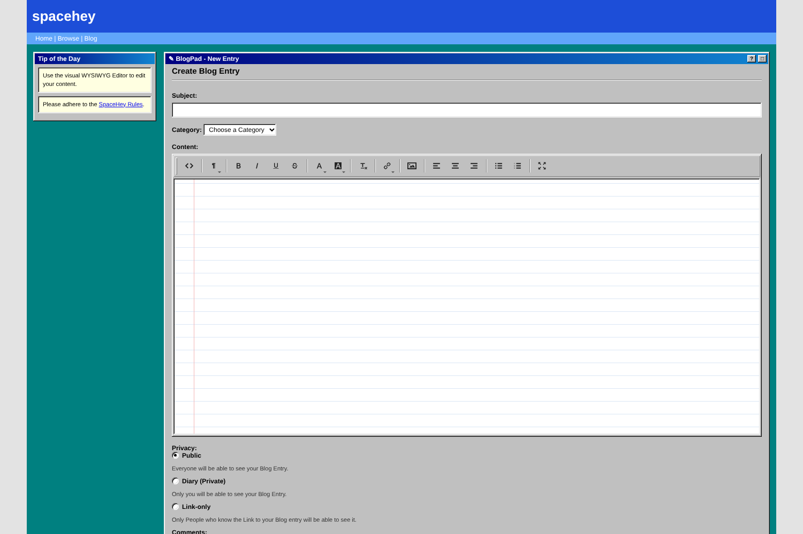

# SpaceHey Overhaul

Two pieces that give SpaceHey a widescreen layout and turn the blog editor into a Windows 98 style writing app ("BlogPad"), while staying true to the 2000s Myspace look.

| Piece | Needs | Install |
|---|---|---|
| Widescreen userstyle | [Stylus](https://add0n.com/stylus.html) | **[spacehey-overhaul.user.css](https://raw.githubusercontent.com/cruxcified/spacehey-overhaul/main/spacehey-overhaul.user.css)** |
| BlogPad editor script | [Violentmonkey](https://violentmonkey.github.io/) | **[spacehey-blogpad.user.js](https://raw.githubusercontent.com/cruxcified/spacehey-overhaul/main/spacehey-blogpad.user.js)** |

Both check their link for new versions automatically.

## What it changes
- **SpaceHey's own pages** (home, browse, search, bulletins, favorites, blog/forum/groups/layouts front pages): widescreen, capped at a max width you can set.
- **Home**: wider columns, bigger Cool New People photos.
- **Blog editor** (`blog.spacehey.com/edit`, via the script): Win98 window and toolbar, ruled paper, Win98 radios and buttons, plus things CSS can't do:
  - **Automatic drafts** every few seconds (this browser only). Leave without publishing and BlogPad offers to restore it next time.
  - **Ctrl/Cmd+S** saves a draft immediately.
  - **Live word count** in the status bar.
  - **Focus mode**: the □ title bar button fills the screen with the editor; Esc leaves it.

The script finds the editor on the page by itself and tags it with its own classes, so it doesn't depend on SpaceHey's class names. It never moves the editor, only adds classes and a title bar/status bar around it.

## What it never touches
Profiles (including `spacehey.com/<username>`), someone's blog page, single blog entries, group pages, layout pages, IM and the shop. The style uses an allow-list of addresses, so any page not listed stays stock.

## Settings
- Userstyle: in Stylus, click the gear next to the style (page width, side space, text size, home column sizes).
- Script: colors, paper lines, writing area height and autosave interval are in the `SETTINGS` block at the top of the script.

## Limits
Drafts live in your browser's storage for blog.spacehey.com, so they don't follow you to another computer, and clearing site data deletes them.

